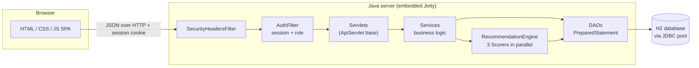
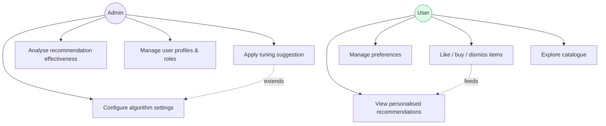
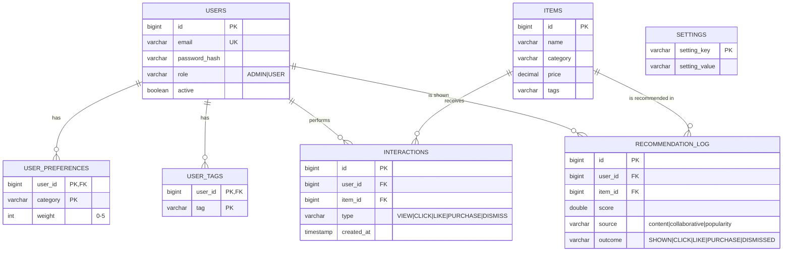
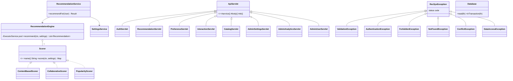
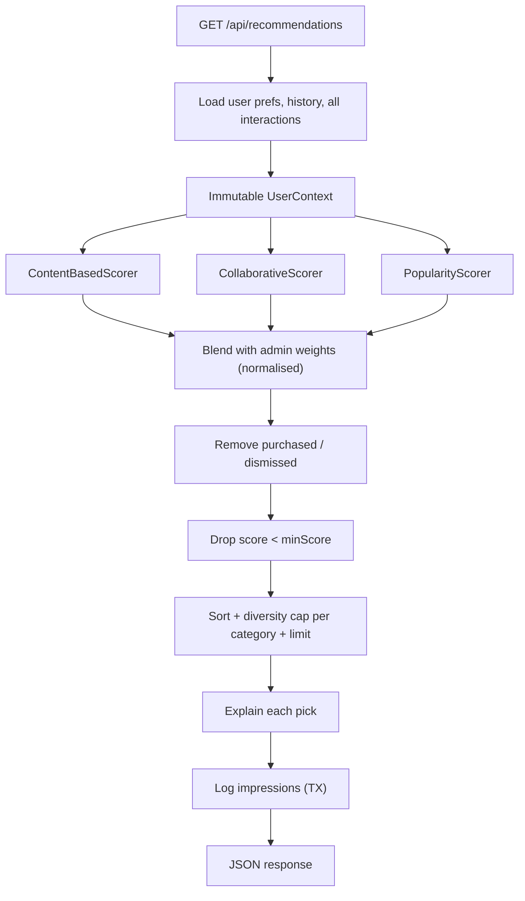
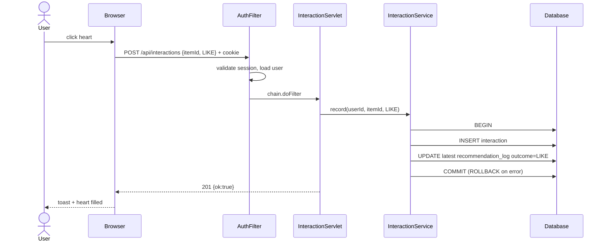

# Design Document

Diagrams use [Mermaid](https://mermaid.js.org) — they render on GitHub, in VS Code (Markdown Preview Mermaid Support) and at mermaid.live (export as PNG/SVG for slides).

## 1. Requirement analysis

**Actors:** Admin, User.

| # | Requirement from brief | Screen | Endpoint | Java classes |
|---|---|---|---|---|
| A1 | System settings management | Admin → System settings | `GET/PUT/DELETE /api/admin/settings` | `AdminSettingsServlet`, `SettingsService`, `RecommendationSettings`, `SettingsDao` |
| A2 | Recommendation effectiveness analysis | Admin → Analytics | `GET /api/admin/analytics` | `AdminAnalyticsServlet`, `AnalyticsService`, `RecommendationLogDao` |
| A3 | Manage user profiles | Admin → Users | `/api/admin/users` | `AdminUserServlet`, `UserService`, `UserDao` |
| U1 | Personalised recommendations | User → For You | `GET /api/recommendations` | `RecommendationServlet`, `RecommendationService`, `RecommendationEngine` |
| U2 | Preference management | User → Preferences | `GET/PUT /api/preferences` | `PreferenceServlet`, `PreferenceService`, `PreferenceDao` |
| U3 | Behaviour capture (feeds U1) | cards: like/buy/dismiss | `POST /api/interactions` | `InteractionServlet`, `InteractionService` |

Non-functional: secure sessions, validated input, atomic updates, responsive UI, explainable output, runs with zero external installs besides JDK + Maven.

## 2. Architecture

## 3. Use cases

## 4. Database (ER diagram)

## 5. Class diagram (core)

## 6. Recommendation pipeline

## 7. Sequence — user likes a recommended item

## 8. Security design

- PBKDF2-HMAC-SHA256, 120 000 iterations, per-user salt; constant-time comparison.
- Session-fixation defence (new session on login), HttpOnly cookie, 30-minute idle timeout.
- Role check for `/api/admin/*` in a single filter; deactivated users are rejected on every request.
- All SQL via `PreparedStatement`; GROUP BY expressions come from a whitelist enum.
- UI never uses `innerHTML` with data (XSS-safe by construction); CSP restricts scripts to same-origin.
- Login throttling: 5 failures → 5-minute lock per e-mail; identical error for unknown user / wrong password.
